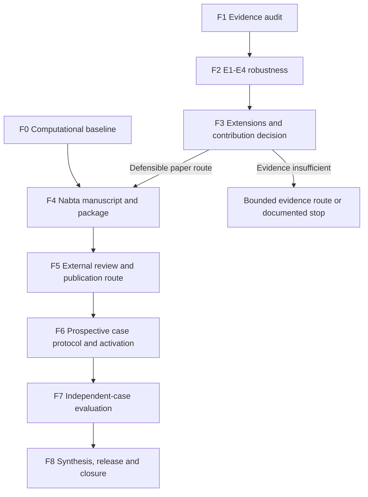

# Research programme completion plan

Version: 27 November 2026. Status: approved scope for planning; execution remains at W1 ready, with E1–E4 pending. This document does not accept any scientific result.

## Goal and authority

The intended outcome is a defensible Nabta case-study publication followed by an independent study that tests whether the developed approach contributes a useful, repeatable method to archaeoastronomy. A negative or conditional finding can be a contribution; publication, transferability and usefulness must be demonstrated, not guaranteed by completing tasks.

This is the detailed expansion of the [roadmap](ROADMAP.md). [PROJECT_PLAN.md](PROJECT_PLAN.md) retains scientific priorities; [PROJECT_STATE.json](PROJECT_STATE.json) and the [work queue](work_packages/WORK_QUEUE.json) retain actual execution status. The [acceptance rules](ACCEPTANCE_CRITERIA.md), [experiment protocol](protocols/EXPERIMENT_PROTOCOL.md) and existing prerequisites remain binding. This plan adds programme coverage, not a second status registry. If documents conflict, stop the affected acceptance and reconcile them explicitly; do not choose the convenient version.

F0–F8 are programme phases, deliberately distinct from publication gates P0–P4. The previous roadmap P0–P6 labels are retired: old P0→F0, P1→F1, P2→F2, P3→F3, P4→F4, P5→F5, and P6→F6–F8. Existing W7 covers the independent-case protocol only. F7–F8 execution requires the governance activation in F6-04; this planning document does not silently extend W7 or alter enforced stage dependencies.

## How to execute and accept work

**Expectation** means the observable output or knowledge sought, not an expected favorable finding. **Acceptance** means evidence that the work answered its bounded question to the stated standard. Neither a passing test nor a worker report alone establishes scientific validity.

For every numbered step, create a bounded packet naming its input versions, listed prerequisites, output paths, reviewer and stopping rule. The phase entry requirements apply to every step; steps follow listed order unless an explicit dependency permits parallel work. Save raw packets/logs under `agent_artifacts/`, runs under `runs/`, and reviewed findings under the existing curated case/docs locations. An accepted record must bind revision, input hashes, methods, outputs, deviations, interpretation, limitations and reviewer decision. Use existing typed records for W/E work; future programme records require the F6 governance amendment. Do not mark a phase complete until all required steps and its exit criterion are met. Optional omission requires a reasoned decision, never an execution claim.

The acting lead owns design, interpretation and acceptance and directly checks evidence. Bounded extraction, inventory and arithmetic checks may be delegated to Hermes with separate review; complex planning and novelty adjudication remain with the lead. An external researcher owns independent reproduction; external specialists supply scientific scrutiny. The project owner decides consequential scope changes, resources, authorship/licensing, outreach and actual submissions. Prepare concrete reviewable choices before requesting input. Existing authorization to publish this repository does not authorize emailing researchers or submitting papers.

There are no invented completion percentages or calendar promises. Estimate effort after each bounded packet is specified. At every phase exit, report the scientific advance, evidence, strongest surviving objection, unresolved blockers and next executable packet. Rate-limit or user pauses preserve exact state and stop workers. A missing input blocks only dependent work; do not repeatedly request known-unavailable survey records or the Sahara article.

## F0 — Establish a trustworthy computational baseline

**Scientific advancement:** Engineering support for scientific comparison: distinguish numerical transport effects from changed scientific conclusions.

**Entry/dependencies:** Can begin now, in parallel with F1.

**Phase expectation:** A diagnosed portability failure and a reproducible, explicitly scoped execution contract.

**Phase acceptance / exit gate:** Every supported environment meets the reviewed contract; every remaining discrepancy has an assessed effect on conclusions. No unexplained numerical failure is described as a successful reproduction.

**Branch and stopping rule:** If unresolved, preserve the failing receipt, restrict the supported environment and block portable-release claims; source review can continue.

| Step | Action and scope | Expected deliverable / knowledge | Acceptance criterion |
|---|---|---|---|
| F0-01 Reproduce the hosted discrepancy | Compare the recorded hosted run with a fresh local run at a specified revision and pinned dependencies; preserve all thirteen table comparisons. | Environment/build inventory and field-level difference ledger with units. | All differing fields, input hashes and execution settings are accounted for; the nine mismatching tables are investigated, not overwritten. |
| F0-02 Diagnose and adjudicate the numerical contract | Trace representative differences to operations and test the proposed explanation with controlled changes. | Root-cause evidence, or an explicit unresolved diagnosis, plus inference-level impact assessment. | Any tolerance proposal is derived per field from numerical behavior and scientific decision margins; regression references remain preserved and any change has a reviewed amendment. |
| F0-03 Verify the supported release path | Run repository checks, tests and the complete pipeline in clean supported local and hosted environments. | Durable run receipts tied to revision, environment, inputs and outputs. | All ten scripts and thirteen comparisons satisfy the accepted contract; failure evidence remains public. This is engineering verification, not independent scientific reproduction. |

## F1 — Establish what the published evidence identifies

**Scientific advancement:** Replace inherited interpretations with an auditable account of identifiable quantities, disputed premises and competing explanations.

**Entry/dependencies:** W0 is complete; existing W1 instructions and acquired sources are available.

**Phase expectation:** A page-linked claim and assumption crosswalk that defines what can actually be tested.

**Phase acceptance / exit gate:** All six W1 tasks have reviewed evidence receipts; every proposed headline has lineage, alternatives, missing inputs and a direct predecessor. Unknown identity or chronology remains unknown.

**Branch and stopping rule:** An inaccessible or inadequate source limits named claims. Omit or condition those claims and proceed with unaffected questions; do not reopen the unavailable Sahara procurement loop.

| Step | Action and scope | Expected deliverable / knowledge | Acceptance criterion |
|---|---|---|---|
| F1-01 Reconcile membership and observation definitions — W1-01 | Compare original tables, text and figures across source versions, including omitted points and changes of labels. | Version-specific point lists, observation-point definitions and missing-value ledger. | Every included coordinate and membership has a source/page and reading status; table and narrative alternatives stay separate; no invented A-10 position or identity crosswalk. |
| F1-02 Audit ordering and selection history — W1-02 | Recover which orderings and groupings were published and which were selected during exploration. | Chronological claim ledger and proposed contrast eligibility table. | Published predictions and post-exposure exploratory choices are distinguishable; dependent republications are not counted as independent observations. |
| F1-03 Test identity alternatives and a control — W1-03/04 | Recheck A-X/A-4 grid descriptions, figure scale and point identity; apply the same rules to A-5/A-6. | Challenge/control premise records with competing interpretations. | Printed evidence supports or qualifies each premise, including the square-size bound; page-space measurements are not promoted to survey coordinates; unresolved alternatives are retained. |
| F1-04 Separate reduction, chronology and interpretation — W1-05 | Trace reported azimuth reductions and date conversions; separate archaeological context from star-fit dates. | Reduction lineage and chronology/claim-scope table. | Every date has its convention, association and inferential role; unexplained reduction and BC/BP discrepancies remain explicit; fitted astronomy cannot validate its own chronology. |
| F1-05 Complete the targeted prior-work review — W1-06 | Compare direct Nabta predecessors and relevant source-critical, uncertainty and alignment methods. Record search terms, dates, inclusion decisions and read depth. | Claim-by-claim overlap matrix and search coverage/limitations record. | Every candidate contribution is compared with the closest substantive predecessor, using pages where available; metadata and abstracts are never represented as full-text review. One bounded update at contribution review captures new literature. |
| F1-06 Freeze the evidence basis for experiments | Reconcile the six task records with the assumption matrix, protocol and source catalogue. | Versioned input manifest and admissible alternative definitions. | Lead reviews original evidence and resolves contradictory records or labels them unresolved; W1 closes only with all six receipts. Experiment-specific acceptance can follow its own established prerequisites. |

## F2 — Determine which Nabta conclusions survive admissible changes

**Scientific advancement:** Produce bounded evidence about robustness, influence and estimand dependence, rather than an attractive nominal reconstruction.

**Entry/dependencies:** Each experiment requires its queue prerequisites; full W2 closure requires all W1 and E1–E4. F0 limits must be reflected in execution receipts.

**Phase expectation:** Complete E1–E4 results, including counterexamples, inconclusive and uncomputable cases.

**Phase acceptance / exit gate:** All eligible cases and exclusions are recorded; implementation checks and archaeological interpretation are separate; results answer the locked questions without choosing favorable alternatives.

**Branch and stopping rule:** At a prescribed computational cap report inconclusive. An unidentifiable physical estimand cannot be rescued by more numerical precision.

| Step | Action and scope | Expected deliverable / knowledge | Acceptance criterion |
|---|---|---|---|
| F2-01 Implement auditable experiment runners | Use new cases/nabta/experiments/<id>/ paths, fixed inputs and fresh output directories; preserve the historical pipeline. | Tested runners, manifests and known-answer/edge-case checks. | Tests exercise scientific failure modes such as angular wrapping, dependence, degeneracy and missing inputs, rather than merely mirror code; a second calculation checks critical quantities. |
| F2-02 Run E1 recording and membership sensitivity | Use source-matched nearest-rounding intervals, separately labelled truncation/wider counterfactuals and consistent shared-origin contrasts. | Per-contrast enclosures and membership sensitivity classifications. | Follow the protocol subdivisions 1, 4, 16 and at most one justified 32 refinement; distinguish positive enclosure, nonpositive upper bound, inconclusive and uncomputable. Samples are not certified extrema. |
| F2-03 Run E2 point and origin influence | Execute leave-one-out complete-row comparisons and the prescribed shared-origin finite grid at 0, 1, 5, 10 and 25 m, with 5-degree directions. | Influence tables under spherical and WGS84 calculations. | All planned eligible cases are reported; one-point bearings are not fitted axes; finite-grid sensitivity is not a continuous bound or probabilistic survey error. |
| F2-04 Run E3 estimand comparison | After E1, E2 and W1-06, compare arithmetic/circular summaries and admissible constrained/free axes. | All fifteen group-pair eligibility decisions and inference comparisons. | Radial directions and fitted axes remain distinct; axial conventions and degeneracies are handled; cross-sector controls are labelled; any claimed method advantage changes an actual inference. |
| F2-05 Run E4 source challenge and control | Evaluate the reviewed A-X/A-4 alternatives and A-5/A-6 control under identical interpretation rules. | Conditional conflict, correction or unresolved outcome for each premise. | A contradiction is attributed to the stated identification assumptions, not ancient displacement; control failure triggers premise review instead of selective reporting. |
| F2-06 Integrate and adversarially review W2 | Check result tables against protocols, source premises and strongest competing explanations. | Accepted experiment records, deviations log and claim-survival matrix. | Lead independently inspects artifacts and critical calculations; every deviation is labelled pre/post exposure; all E1–E4 and W1 receipts exist before W2 closes. |

## F3 — Choose a scientifically justified contribution

**Scientific advancement:** Identify what the case adds beyond its predecessors, including a useful negative or conditional result.

**Entry/dependencies:** W1 and W2 accepted; no manuscript rewrite substitutes for this decision.

**Phase expectation:** A defended contribution decision and explicit decisions on both optional extensions.

**Phase acceptance / exit gate:** W3 records executed or omitted-with-reason branches; W4 chooses a paper form from evidence and prior-work comparison, with falsifiers and limitations.

**Branch and stopping rule:** Choose full case study, narrower replication/source-critical note, evidence-collection route or no submission. Escalate a major change of research aim to the owner with concrete options.

| Step | Action and scope | Expected deliverable / knowledge | Acceptance criterion |
|---|---|---|---|
| F3-01 Decide E5 simulation utility | Specify what calibration or failure-detection question remains after E1–E4 and whether a simulation could discriminate it. | Execute/omit decision with cost, comparator and stopping rule. | If executed, lock geometry, corruption mechanisms, seeds, metrics and equal-information comparisons before outcomes; assess coverage and inconclusive rates. Hidden-violation examples are not estimates of ancient false-positive rates. |
| F3-02 Decide E6 astronomical eligibility | Check identifiable geometry, a fixed published target hypothesis, visibility/horizon assumptions and independent chronology. | Execute/omit decision; if eligible, locked model and sensitivity results. | All prerequisites hold before execution; no unrestricted target search or circular dating. If absent, omit the astronomical inference explicitly without treating omission as an executed test. |
| F3-03 Adjudicate novelty and consequence | Update the bounded literature comparison and assess strongest alternative explanations against accepted results. | One-sentence contribution, nearest predecessor comparison, archaeological consequence and overturning evidence. | A result changes an inference, identifies a consequential failure mode or specifies discriminating evidence; novelty is not inferred from new software, more decimals or a previously unused label. |
| F3-04 Select paper form and freeze the claim set | Review full study, narrower note and non-submission alternatives. | W4 decision and accepted/qualified/rejected claim register. | Each retained claim has evidence, assumptions, scope and a reason it matters; unsupported original-position, intention and framework-generalization claims are excluded. Negative findings can pass this gate. |

## F4 — Produce a reviewable Nabta paper and research package

**Scientific advancement:** Turn the accepted contribution into an inspectable scientific argument others can reproduce and challenge.

**Entry/dependencies:** W4 selects a defensible paper route; unresolved F0 limits constrain release wording.

**Phase expectation:** Manuscript, figures, source-linked evidence and a versioned reproducibility candidate.

**Phase acceptance / exit gate:** Every central claim is traceable to accepted evidence; all tables/figures reproduce; citation, numerical and scope audits pass. This closes preparation, not peer review.

**Branch and stopping rule:** If writing exposes a missing premise or changed claim, reopen the relevant gate and record the amendment; do not patch the narrative around it.

| Step | Action and scope | Expected deliverable / knowledge | Acceptance criterion |
|---|---|---|---|
| F4-01 Rewrite the scientific argument | Organize question, prior work, evidence, methods, results, competing explanations and limitations around W4. | Revised manuscript with a claim-to-result crosswalk. | Abstract and conclusion do not exceed accepted results; discovery/exploration history and all material negative outcomes are disclosed. |
| F4-02 Regenerate figures and inspect communication | Build figures and tables from accepted runs and label coordinate systems, units, uncertainty meanings and exclusions. | Versioned figure sources, captions and visual review record. | Every plotted quantity traces to an input/run; uncertainty is correctly described; no map suggests verified ancient positions where only conditional geometry exists. |
| F4-03 Audit citations and research rights | Check Chicago author–date citations and pinpoint pages against the reference registry; identify source access and redistribution restrictions. | Citation audit and release rights inventory. | Every citation resolves; quoted wording is checked and limited; source read depth is accurate; restricted PDFs and private worker material remain excluded. Owner decisions on authorship and licence are recorded before relevant publication. |
| F4-04 Prepare the reproducibility candidate | Document installation, complete execution, expected results, limitations and source procurement; bind inputs and outputs to a revision. | Tagged candidate package with durable receipts and known-issues list. | A fresh supported installation runs from public instructions without private paths; numerical comparison meets the F0 contract; unavailable full texts and any external assets are declared rather than implied to be bundled. |

## F5 — Obtain external scrutiny and complete the Nabta publication route

**Scientific advancement:** Test whether independent researchers can reproduce the work and whether specialists find the argument defensible.

**Entry/dependencies:** W5 package ready; owner authorization required for actual outreach and submission.

**Phase expectation:** External reviews, independent reproduction, responses and a publication disposition.

**Phase acceptance / exit gate:** W6 and existing publication gates close only with required external attestations and owner decisions; paper acceptance is recorded only when actually received.

**Branch and stopping rule:** After each review/rejection, assess whether revision can resolve objections. After two substantive revision or venue cycles, hold an owner decision review before further submissions; no endless resubmission loop.

| Step | Action and scope | Expected deliverable / knowledge | Acceptance criterion |
|---|---|---|---|
| F5-01 Arrange independent review and reproduction | Prepare concrete reviewer packets and requests for archaeology/method expertise and an independent researcher run. | Authorized requests, declared relationships and returned reports/run receipts. | Actual people external to this agent workflow inspect the work; internal models and same-host reruns are not substitutes. If unavailable, mark external validation pending. |
| F5-02 Resolve external objections | Map each substantive criticism to evidence, a correction, a justified disagreement or an unresolved limitation. | Response matrix and revised accepted artifacts. | No material objection is silently dropped; changed analyses trigger relevant revalidation and post-exposure labels; independent reproduction meets its agreed scope. |
| F5-03 Prepare and submit to an appropriate venue | Compare scope and requirements, settle authors/contributions, rights and disclosures, then prepare submission files. | Owner-approved venue/package and submission receipt. | Submission occurs only with explicit owner approval of the concrete package; all venue requirements and data/code statements are checked. Prepared, submitted and accepted remain distinct states. |
| F5-04 Close the paper publication track | Respond to reviews, verify proofs and link the version of record and underlying release, or record a reasoned withdrawal/non-submission. | Publication record and archived release, or explicit unresolved/terminated disposition. | Acceptance/publication requires documentary evidence; repository release alone does not satisfy it. An honest stopped track closes administration but does not achieve the intended publication outcome. |

## F6 — Freeze a prospective independent-case test

**Scientific advancement:** Convert lessons learned on Nabta into falsifiable transfer claims without tuning them to the next case.

**Entry/dependencies:** W6 before formal W7 acceptance under current dependencies; candidate scoping can be preparatory only.

**Phase expectation:** W7 protocol plus an approved activation plan for the remaining research programme.

**Phase acceptance / exit gate:** Case selection, transfer claims, baselines, metrics, thresholds and stopping rules are fixed before outcome analysis; new execution stages are registered and validated before use.

**Branch and stopping rule:** Reject inaccessible or non-discriminating cases using recorded criteria. If none qualifies, report validation blocked; do not label another Nabta analysis independent.

| Step | Action and scope | Expected deliverable / knowledge | Acceptance criterion |
|---|---|---|---|
| F6-01 Define the candidate framework and applicability domain | Extract only supported reusable steps, required evidence and explicit failure conditions from Nabta. | Versioned framework specification with testable transfer claims. | Each component has a scientific purpose, required input and observable output; Nabta-specific assumptions are isolated; no general utility claim rests on packaging alone. |
| F6-02 Select an independent case transparently | Screen a bounded initial shortlist of three to five cases for accessible evidence, contrasting failure modes and feasibility before analysing target outcomes. | Selection ledger including rejected cases and exposure history. | Selection is justified without choosing a favorable result; reused sources and prior familiarity are disclosed; the chosen case can challenge at least one substantive transfer claim. |
| F6-03 Lock comparative validation design | Define baseline workflows, equal-information comparisons, primary/secondary outcomes, uncertainty treatment and minimum useful improvement. | Timestamped protocol with thresholds, analysis budget and stopping conditions. | Thresholds are justified from the decision question before outcomes, not invented afterward; distinguish accuracy where ground truth exists from auditability or uncertainty disclosure where it does not. Include null/negative controls where meaningful. |
| F6-04 Activate second-case execution governance | Create bounded packages for F7–F8, typed output/acceptance records and the required state/validator amendments. | Reviewed queue, dependency graph and resource plan. | W7 remains protocol-only; new stage IDs and evidence requirements are explicit and tested before marking any new stage complete. Owner resolves consequential scope, access, cost or participation choices. |

## F7 — Test transferability on independent evidence

**Scientific advancement:** Establish whether the candidate workflow remains useful outside its development case and identify its boundaries.

**Entry/dependencies:** F6 protocol accepted and execution stages activated; required evidence available.

**Phase expectation:** Independent-case results, comparative evaluation and a qualified framework decision.

**Phase acceptance / exit gate:** All locked primary outcomes and exclusions are reported; adaptations and post-exposure revisions are separated from the frozen evaluation; conclusions stay within the tested domain.

**Branch and stopping rule:** A failed transfer is a result: revise or narrow the framework. Any revised version needs new prospective evidence before renewed confirmatory claims; do not rebrand the same exposed case as a fresh test.

| Step | Action and scope | Expected deliverable / knowledge | Acceptance criterion |
|---|---|---|---|
| F7-01 Build the new case evidence ledger | Repeat provenance, identity, chronology and competing-explanation review using the frozen intake rules. | Reviewed case-specific data and missingness/assumption records. | Source lineage and dependencies are complete for tested claims; unavailable data restrict the relevant inference; no undocumented Nabta-specific shortcut is imported. |
| F7-02 Execute the frozen comparison | Run framework and baselines with the same allowed information and recorded computational settings. | Results for all primary metrics, controls and planned sensitivity analyses. | The protocol is followed or deviations disclosed; critical calculations are independently checked; inconclusive and adverse outcomes are retained; no outcome-driven threshold changes. |
| F7-03 Evaluate transfer and adaptation cost | Compare inferential effects, error detection, uncertainty behavior and documented effort using the locked definitions. | Cross-case evidence matrix and frozen-versus-adapted comparison. | Claims distinguish demonstrated transferable components, case-specific components and failures; two cases do not establish universality or a population-level success rate. |
| F7-04 Make the framework contribution decision | Assess whether results support a reusable method, a bounded diagnostic workflow or only separate case findings. | Accepted scope statement and follow-up paper decision. | Decision names domain, evidence strength, closest prior methods, failure conditions and what further cases would overturn it; a negative decision is admissible and not concealed. |

## F8 — Publish the synthesis and close the research programme

**Scientific advancement:** Make the supported contribution independently inspectable, reusable within its demonstrated scope and durable.

**Entry/dependencies:** F7 evaluated; publication route justified and owner decisions available.

**Phase expectation:** Synthesis/follow-up paper, reviewed framework release and final scientific closure record.

**Phase acceptance / exit gate:** Independent scrutiny and reproducibility address both cases; publication status is evidenced; documentation states tested scope, unresolved limitations and future work without inflating generality.

**Branch and stopping rule:** If synthesis publication or generalization is unsupported, release the defensible bounded results where authorized and record the unmet objective. Further research becomes a new scoped programme.

| Step | Action and scope | Expected deliverable / knowledge | Acceptance criterion |
|---|---|---|---|
| F8-01 Write and externally review the synthesis | Explain the transferable method, independent test, comparison, failures and applicability limits; use the F5 external-review standard. | Follow-up manuscript and external response/reproduction records. | Every general claim maps to cross-case evidence; adapted results are not presented as prospective validation; material specialist objections are resolved or explicitly limit the claim. |
| F8-02 Submit and finalize the second publication | Prepare venue-specific files, owner-approved submission and finite review cycles as in F5. | Submission, review and final publication/disposition records. | Actual acceptance/publication is verified; authorship, rights, disclosures and research releases are consistent. Unpublished material is labelled accurately. |
| F8-03 Release a maintainable framework | Promote only demonstrated shared components; supply case adapters, examples, schemas, tests, provenance and change policy. | Versioned release and new-maintainer walkthrough. | A new maintainer can reproduce both supported cases and understand a third-case intake without private agent context; licensing decisions and source-access limitations are explicit; no unsupported generic API is advertised. |
| F8-04 Audit completion and hand over stewardship | Review every phase, accepted claim, deferred issue, publication record and remaining external dependency. | Final objective-to-evidence matrix and maintenance/archive decision. | Owner can distinguish achieved scientific advances, unmet ambitions and administrative closure; no open scientific claim is marked validated merely because tasks ended. Future extensions have separate questions and gates. |

## Dependency and completion crosswalk

| Programme phase | Existing execution gate | What changes scientifically |
|---|---|---|
| F0 | Engineering prerequisite; no scientific stage closure | Numerical execution gains a defensible transport contract |
| F1 | W1; publication P1 supports source audit | Published evidence becomes a defined set of testable premises |
| F2 | W2 / E1–E4 | Robust, fragile and uncomputable inferences are distinguished |
| F3 | W3 / E5–E6 decisions, then W4; publication P0 design review | The contribution and justified paper form are determined |
| F4 | W5 | Accepted findings become an auditable argument and package |
| F5 | W6; publication P2/P3 external attestations and P4 owner decisions | External scrutiny tests the case study; publication disposition follows |
| F6 | W7 protocol only; activate subsequent execution stages | Transfer claims become prospectively testable |
| F7 | New stages required by F6-04 | Transferability and failure boundaries are measured |
| F8 | New stages required by F6-04 | Supported cross-case contribution is scrutinized, published and handed over |

F0 diagnostics and F1 evidence review can run in parallel. E1/E2 require W1-01 and W1-02; E3 requires E1, E2 and W1-06; E4 requires W1-03 and W1-04. Full W2 additionally requires all W1. W4 requires W1, W2 and W3. F5's external response work may uncover a need to reopen earlier phases. Under the current registry W7 acceptance follows W6, but no requirement to wait for a journal's publication date is added to W6. Prospective scoping must not expose the confirmatory second-case outcomes prematurely.

## Immediate executable packets

1. **Engineering packet:** reproduce and localize the hosted numerical discrepancies (F0-01/02); acceptance is a complete field-level ledger and a tested diagnosis or explicit unresolved outcome, not green CI by altered thresholds.
2. **Evidence packet:** W1-01 and W1-02 (F1-01/02), with source pages and alternative memberships; concurrently prepare the identity/control evidence for W1-03/04. Stop each packet at its fixed source list and record unresolved references.
3. **Integration packet:** complete W1-05/06, then freeze the evidence/alternative definitions. E1/E2/E4 preparation may overlap only where their own premises are reviewed.
4. **Experiment packet:** implement and run the bounded E1–E4 questions, preserving the baseline; review the resulting claim-survival matrix before optional extensions or manuscript expansion.

No new owner input is required for these planning and existing-source tasks. Raise only a concrete essential access/resource barrier, a consequential change of objective, or a prepared external-action decision.

## Definition of project completion

The intended scientific goal is achieved only if the Nabta contribution survives appropriate scrutiny and the follow-up supplies evidence for a useful, explicitly bounded repeatable approach, with the intended publications actually accepted/published and reproducible releases available under settled rights. The programme may instead end with a defensible narrower contribution, failed transfer or no publishable claim. In that event, complete the evidence archive and disposition honestly, name the unmet objective, and obtain an owner decision on a new research direction. Administrative closure must never be reported as scientific success.
