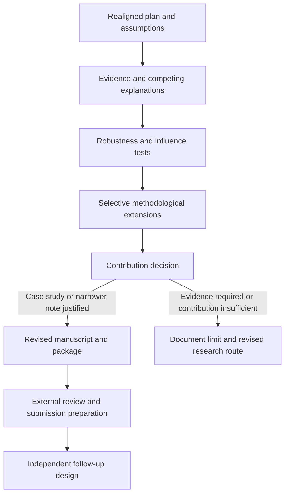

# Nabta research action plan — realigned 25 October 2026

## Objective and current position

Develop a defensible contribution through a Nabta case study, then test transferability on an independent case. The scientific question remains provisional: **which conclusions can the published radial-alignment evidence actually support, and what changes when its source, membership and observation assumptions are made explicit?** The case study must justify its own value. A general framework is a later proposition to test.

Current stage: scientific design and evidence validation. We have a working manuscript, source ledgers and a repeatable numerical package. Those are preserved research outputs. They do not close the question of contribution or archaeological interpretation. Publication preparation resumes after the decision below.

Canonical records: this plan sets priorities; [PROJECT_STATE.json](PROJECT_STATE.json) records progress; [RESEARCH_CHARTER.md](RESEARCH_CHARTER.md) records the enduring objective. Historical assessments remain evidence of earlier reasoning, not current task queues.

## What is preserved and what changes

Preserve legacy materials, source PDFs, verified transcriptions, all conditional numerical findings, the current draft and private reviewer archive. No existing scientific result is erased merely because the plan changes. Baseline hashes and previous front-page files are saved in [the review directory (local archive)](LOCAL_ARCHIVE.md).

Replace the assumption that the remaining work is mostly citation checking and submission preparation. Reopen research design, interactions among assumptions, selection history and the importance of each result. Existing findings remain conditional; candidate methods are judged by whether they answer a consequential question.

## Ordered work and completion gates

| Stage | Action | Reviewable deliverable | Completion gate |
|---|---|---|---|
| W0 | Realign and specify the review | Current plan; assumption matrix; experiment protocol; preserved baseline | These artifacts agree about scope, priorities and pending work. Complete as a planning step, not as scientific validation. |
| W1 | Audit evidence, claims and competing explanations | Page-linked claim/assumption crosswalk; tested identity alternatives; literature search and inclusion record | Every candidate headline result has its input lineage, strongest alternative explanation, unresolved premises and direct predecessor identified. Missing evidence is mapped to the specific claim it limits. |
| W2 | Execute the bounded robustness and influence tests | E1–E4 results, complete eligibility/exclusion table, implementation checks and interpretation | Each planned question has a documented outcome; failures and inconclusive cases retained; mathematical and archaeological conclusions distinguished. |
| W3 | Decide and perform only useful methodological extensions | E5 decision and, if warranted, locked simulation design/results; E6 branch decision | Added methods either change an inference, reveal a failure mode or specify useful evidence. Rejected additions have recorded reasons. No method is added merely to enlarge the paper. |
| W4 | Decide the contribution and paper form | Written decision comparing results with prior work and strongest objections | Choose strengthened full case study, narrower replication/source-critical note, a defined evidence-collection route, or no submission of the present claim set. No automatic preference for a full paper. |
| W5 | Rebuild the manuscript around accepted findings | Revised manuscript, figures, claim-to-source audit and portable release candidate | Every claim follows the contribution decision, experimental scope and source evidence; provisional or obsolete claims removed or qualified. |
| W6 | Obtain external scrutiny and prepare submission | Specialist feedback and response log; external reproduction; venue/author/licence decisions | External concerns addressed and journal requirements met. Sending correspondence, publishing or submission requires the relevant user authorization. |
| W7 | Design the independent follow-up | Prospective second-case question, sampling/selection and validation protocol | Independent evidence can test transferability; no claim that Nabta development work already validates a general framework. |

W1 and limited preparatory W2 work can overlap, but a source-dependent test cannot be accepted before its relevant W1 premises are reviewed. Literature review continues alongside W2; evidence may legitimately change the scope. Amend the protocol openly when that happens.

## Immediate execution sequence

1. Finish W1 for the proposed headline findings: source/membership sensitivity, northern ordering and the A-X/A-4 conflict. Verify the challenge pair and the compatible control; separate public claim definitions from our exploratory selections. Review chronology and the restricted combined-survey test as supporting or potentially removable findings.
2. Run E1 recording/membership tests and E2 point/origin influence with source-matched alternatives. Compile E3 eligibility and estimand comparison; complete E4 source challenge. The [assumption matrix](protocols/ASSUMPTIONS.md) and [experiment protocol](protocols/EXPERIMENT_PROTOCOL.md) define the initial scope.
3. Review outcomes before authorizing E5 simulation or any astronomical expansion. Report what failed as well as what survived. Then make W4's contribution decision before rewriting the paper.

The initial [scientific review](protocols/REVIEW.md) supplies the objections to test. Its R0–R8 suggestions are now organized into W0–W7 and E1–E6; they are not a separate competing work queue.

## Ownership and delegation

The main agent owns research questions, method choice, assumption admissibility, interpretation, acceptance and scope decisions. Hermes remains a dedicated DeepSeek Flash/medium manager for 3–6 small workers when enough independent bounded tasks exist. Appropriate packets: exact page extraction, citation identity checks, arithmetic or inventory checks with fixed inputs. Do not delegate planning, novelty adjudication, complex method design or scientific acceptance. Each packet must have input scope, output schema, task budget and a separate main-agent review. No standing background worker loop is required.

The first packet is complete. Its findings and process deviations remain recorded. Raw worker reports are suggestions until checked against original evidence; manager confidence is not a substitute for that review.

## Blockers, decisions and stopping rules

- Sahara remains assumed unavailable; do not repeatedly request it. Haynie2014 is acquired and reviewed.
- No unpublished survey records or existing researcher contact are available. Original ancient-position reconstruction remains evidence-limited; do not manufacture a point crosswalk.
- No user decision is required to begin W1–W2. Escalate a genuinely consequential scope choice, new inaccessible essential input, paid access, external communication or submission decision. Provide the concrete options and consequences first.
- Report after evidence audit, stress-test outcomes, the contribution decision, or a real blocker. Report rate-limit interruption truthfully and preserve the next action.
- Keep failed, negative and inconclusive results. Stop an uninformative branch when it cannot distinguish the alternatives with available evidence; continue unaffected work.
- External specialist review and external reproduction remain external needs. Internal checks, Hermes reviews and a second same-host run must never be relabelled as independent human acceptance.
- No publication probability, completion percentage or timetable is inferred from the number of files produced.

Accepted plans, protocols, code and evidence now live in the curated repository directories. Worker scratch files and raw transcripts remain under agent_artifacts. Legacy remains unchanged.

## Repository organization 23 November 2026

This is the canonical plan; PROJECT_STATE.json beside it records current execution. The October research status remains W1 ready; organization has not executed E1–E4. The assumption matrix and experiment protocol are under protocols/. Work-package instructions and output schemas are under [work_packages](work_packages/README.md). The former agent_artifacts plan is a preserved historical snapshot. Numerical reproduction is documented in [REPRODUCIBILITY.md](REPRODUCIBILITY.md).

## Deep audit and enforceable acceptance — 23 November 2026

The [audit record](audits/2026-11-23-DEEP_AUDIT.md) reconciles two model critiques with main-agent evidence checks. [Acceptance criteria](ACCEPTANCE_CRITERIA.md) now govern record validation, evidence-bound closure, dependency checks and numerical receipts. Individual E1–E4 work may be accepted when its listed source premises close; entire W2 still requires W1 and all four experiments. E5/E6 decisions are explicit queue items; a documented omission can close a conditional branch without implying execution. The historical scientific pipeline remains a fixed regression benchmark, not the engine for new experiments with unknown outcomes.

No scientific stage is advanced by this audit. W1 remains next. The existing draft's contribution language remains provisional pending W1–W4, and source-specific uncertainty remains visible.

## Whole-programme completion plan — 27 November 2026

The [completion plan](COMPLETION_PLAN.md) expands the programme through independent-case execution, synthesis publication and closure. It defines expectations and acceptance at both step and phase level. W0–W7 remain the current execution stages; W7 is protocol-only, and later execution requires the explicit governance amendment specified in F6-04. Scientific status and existing prerequisites are unchanged.
