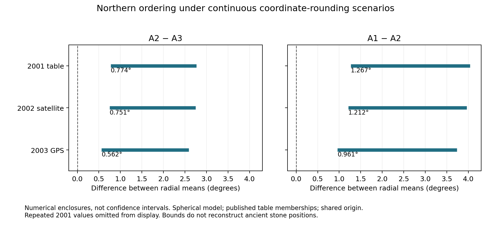
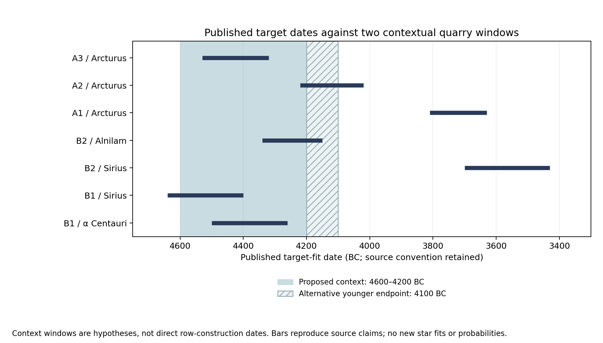

# Reassessing the published radial alignments at Nabta Playa

**Working manuscript, 25 October 2026.** Results are conditional on the specified documentary inputs. This draft has not passed independent specialist review, comprehensive novelty review or journal preparation. Author details and venue are intentionally unset. Internal claim IDs refer to the accompanying evidence register and should be removed or converted into supplement links before submission.

> **Audit status, 23 November 2026:** preserved provisional draft. The [deep audit](../audits/2026-11-23-DEEP_AUDIT.md) does not accept its contribution claims or close W1–W4. Numerical reproduction and source-page coverage are distinct.

## Abstract

Astronomical interpretations of archaeological alignments depend on both reproducible geometry and the identification of the physical features represented by the measurements. We reassess the published radial alignments at Nabta Playa using source-specific coordinate transcriptions, alternative memberships, explicit calculation definitions and contextual chronology. Six historical recalculated mean bearings are reproduced to their published rounding. Changing the documented membership of one northern group changes its reconstructed mean direction by approximately 1.07°. Despite such sensitivities, interval calculations preserve the ordering of the three northern groups throughout the specified continuous coordinate-rounding ranges under a spherical model. This numerical stability does not establish prehistoric stone positions. Comparison with a later archaeological monograph identifies an unresolved location conflict involving A-X and A-4, while fragment maps do not provide a unique correspondence to the older surveyed representatives. Published target-date ranges also differ in their compatibility with proposed quarry-activity windows, which do not directly date individual rows. The case distinguishes conclusions recoverable from the numerical record from those requiring further archaeological identification. It supports a qualified reassessment rather than a new stellar identification or a general claim about astronomical intention.

## 1. Introduction

The megalithic remains at Nabta Playa have supported several interpretations of cardinal, solar and stellar alignment (Malville et al. 1998; Wendorf and Malville 2001). The radial groups associated with Complex Structure A are especially relevant to the relationship between published coordinates, reconstructed directions and astronomical chronology. Their interpretation has changed through subsequent coordinate reassessment and archaeological discussion (Brophy and Rosen 2005; Malville et al. 2007; Haynie 2014; Malville 2015; Schild 2025).

These publications do not constitute independent measurements of an unchanging, fully identified object. Some coordinates repeat earlier tables. Different descriptions assign different members to a group. Surviving remains include upright bases, fallen stones and fragmented clusters. The meaning of a representative point is therefore part of the archaeological problem, rather than a detail resolved by numerical precision alone.

Uncertainty analysis and computational treatment of structural orientations are established approaches. Silva (2017, 2020) examines statistical inference, measurement distributions and coordinate transformations; skyscapeR supplies an extensive computational toolkit (Silva 2021). Our question is narrower: which conclusions about Nabta's published radial groups remain supportable when the documentary source, membership, observation unit and chronological association are kept explicit?

Haynie (2014:64–68) already reassessed published angle–date correspondences, considered visibility assumptions and alternative targets, and compared proposed alignment dates with archaeological context. His coordinate schematic also reports row correlation coefficients (2014:66, Fig. 2). Our contribution therefore cannot rest on reassessment or chronological comparison alone. It concerns the traceable documentary alternatives and the specific bounded results and later-map conflicts tested below.

The analysis separates numerical reproduction, physical reconstruction and astronomical interpretation. It does not assume that failure at one level erases every result at another. In particular, relative ordering can remain stable in a coordinate record whose absolute prehistoric interpretation remains uncertain.

## 2. Sources and methods

### 2.1 Documentary units

We retain the original 2001 coordinate table, its repeated version in Brophy and Rosen (2005), and the latter paper's satellite and GPS versions as separate documentary inputs. The ledger contains 100 source-labelled entries, including origin entries and missing observations. This is a count of records, not 100 independent surveyed monuments. Missing GPS values remain missing. The repeated original-table version contains two C-coordinate differences: C-1 longitude is 30.7333° in the original and 30.7330° in the repeat; C-3 latitude is 22.5025° and 22.5028°, respectively. Dependence between versions does not imply literal identity of every entry.

The 2025 monograph supplies additional survey history, maps, archaeological descriptions, quarry chronology and a catalogue of remains. Maps were visually checked, and selected vector paths were extracted in drawing coordinates. These paths were not converted automatically into monuments, historical survey IDs or ancient positions. The early Sahara account remains unavailable; no argument requiring its exclusive content is asserted. Unpublished field records and an authoritative correction to the unresolved identities were also unavailable for this analysis.

Brophy and Rosen (2005:19) describe holding a GPS receiver over an estimated centre of a megalith or its fragments. A general observation convention is thus available. The unresolved issue is the exact correspondence between those representatives, particular surviving fragments or bases, and the later mapped objects.

### 2.2 Bearings, memberships and estimands

The reproduction calculation averages individual bearings from Complex Structure A, following the historical radial-mean definition. Spherical and assumed-WGS84 calculations are kept distinct. A circular mean and an origin-constrained perpendicular-distance fit are examined as alternative estimators; the latter weights longer sightlines more strongly and is not an automatic correction to a radial bearing mean.

Narrative and tabular memberships are evaluated separately. Where a narrative member has no available coordinate, its absence is retained and the partial result is not treated as a complete-row estimate. We also test a deliberately restricted reduction family: nonnegative weighted combinations of the reconstructed satellite and GPS row means. Failure of that family does not exclude other reductions, different point weights or calculations using unrounded observations.

### 2.3 Coordinate rounding and shared origins

Under a declared nearest-rounding scenario, each printed latitude and longitude varies by ±0.00005°. These ranges express information loss at the printed resolution; they are not empirical survey-error distributions. Source variations, membership alternatives and hypothetical origin displacements are distinct diagnostics and are not added in quadrature.

For the northern groups, a continuous interval calculation uses the spherical initial-bearing formula

\[
A=\operatorname{atan2}\left(\sin\Delta\lambda\cos\phi_i,\;\cos\phi_o\sin\phi_i-\sin\phi_o\cos\phi_i\cos\Delta\lambda\right),
\]

where the subscripts identify the origin and an individual point. All evaluated intervals remain in the positive-numerator, positive-denominator region, avoiding angular wrap and singularities for this subset.

The origin is shared across groups within each contrast. Its latitude–longitude domain is partitioned into progressively finer boxes, while each stone retains its full rounding box. Interval evaluations enclose the difference between the arithmetic group means on every origin box; their union covers the stated domain. The final calculation uses 256 origin boxes and 35-digit interval precision. Enclosure endpoints are conservative bounds, not necessarily attained extrema. The result is limited to the spherical model, published memberships and the specified rounding domain.

### 2.4 Chronological comparison

We preserve the date labels printed in each publication. Five matched 2007 BC and 2015 BP ranges differ arithmetically by exactly 2,000 years at both endpoints. This observation does not establish a corrected epoch convention; the ranges are not silently pooled.

For the contextual comparison, seven dated target claims from Malville et al. (2007) are retained in their BC convention and compared with the proposed 4600–4200 and 4600–4100 BC activity windows discussed by Królik et al. (2025:104–105). The comparison reports interval intersections and gaps only. It neither recalculates stellar positions nor assigns probabilities to chronological overlap. Quarry charcoal dates are treated as contextual evidence, not independent direct dates for individual rows. This dataset tests the specified 2007 target-date claims; it does not pool or exhaust later alternatives, including Haynie’s (2014:68) proposed 4400–4300 BC episode.

## 3. Results

### 3.1 Reproduction and definition sensitivity

All six recalculated-WM means in Brophy and Rosen (2005) are reproduced within 0.005° using the specified spherical arithmetic mean (C01). This validates that calculation from the printed inputs; it does not validate the underlying survey or reproduce every final direction in the paper.

For A2, the sourcebook narrative membership produces 29.8051°, compared with 28.7355° for the tabular membership under the assumed-WGS84 calculation, a difference of 1.0696° (C02). The narrative A1 and C alternatives cannot be completed from the original numerical table alone.

For the four groups having complete satellite and GPS rows, the final published directions fall outside the convex combinations of the two reconstructed row means under both tested Earth models (C03). The failure concerns this restricted family; it does not show that the published final directions were incorrectly calculated from the authors' underlying data.

Circular and arithmetic means differ by at most approximately 0.000185° among complete groups. The origin-constrained fit differs from the arithmetic mean by up to approximately 0.2604° (C04). These comparisons show the need to specify the quantity being estimated before interpreting differences between methods.

### 3.2 A positive result: northern ordering

The continuous interval calculation preserves A3 < A2 < A1 in every northern source-table version within its stated domain (C11; Figure 1). Using the final 256-box origin partition, the smallest lower enclosures across versions are approximately 0.5619° for A2 minus A3 and 0.9607° for A1 minus A2. These are positive conservative bounds, not estimated probabilities or exact minimum separations.

Refining the origin partition tightened the enclosures. Nominal spherical bearings agreed with an independent inverse-geodesic implementation within 3.9 × 10⁻¹¹ degrees. A further 24,000 independently calculated sampled contrasts lay within the interval enclosures. Sampling checks implementation consistency; interval evaluation supplies coverage of the continuous declared domain. Earlier WGS84 results remain finite-grid findings and are not upgraded by this spherical calculation.

### 3.3 An unresolved physical correspondence

Schild (2025:140) assigns both A-X and A-4 to Sector B square r/20. The 2001 map instead places A-X near A5 and south of A4, while the earlier coordinate versions imply A-X–A4 separations of approximately 161–171 m (C06).

After allowing the stated coordinate rounding, the minimum north–south separation remains approximately 132.88 m. A square with a side no greater than 50 m has a diagonal no greater than 70.71 m. The same-square interpretation therefore fails this permissive conditional test. A raster scale check implies a substantially smaller cell, approximately 27.45–28.83 m with the specified endpoint-picking tolerance. The calculation does not determine whether the conflict reflects labelling, transcription, different observed features or another source problem. No correction is selected.

For B1 and B2, 28 red drawing paths occur in ten cells identified in the 2025 description. Textual fragment counts and drawing-path counts differ in four cells. Those counts are not interchangeable archaeological inventories, and the inspected material does not supply a unique mapping to the older coordinate IDs (C09). Increasing digitization precision would not itself establish that correspondence.

### 3.4 Contextual chronology

The published A1–Arcturus range does not intersect either proposed quarry window, with minimum gaps of 390 or 290 years. The later B2–Sirius range likewise has gaps of 500 or 400 years. A2's overlap changes from 20 to 120 years when the younger contextual endpoint changes from 4200 to 4100 BC. Both B1 candidate ranges overlap both windows (C08; Figure 2).

These results express conditional compatibility with a proposed context. The monograph allows undated quarry pits and potentially later extraction and does not directly date each row's installation. Non-overlap cannot therefore be promoted to a conclusive rejection of a target, and overlapping durations cannot be interpreted as target probabilities. For B1, this chronological comparison does not discriminate between the two published candidates.

## 4. Discussion

The positive and unresolved findings concern different levels of inference. Northern ordering is recoverable from the printed coordinates under the stated membership and rounding assumptions. That result does not require a preferred star. Conversely, transferring the directions to original prehistoric structures requires a documented connection between coordinate representatives and physically identified features, including their preservation histories.

This distinction develops a specific case rather than introducing uncertainty analysis to the field. Brophy and Rosen already recognized possible fragment-identification differences; Malville and colleagues discussed preservation and chronological constraints; Haynie reconsidered target assignments, visibility and archaeological chronology; Silva's methods provide established tools for probabilistic orientation analysis. The present contribution lies in testing which conclusions can be retained from this documentary record while making the remaining correspondence requirements explicit. A broader claim of methodological novelty would require further evidence.

The resulting data requirement is concrete. A labelled observation-point inventory, correction of the A-X/A-4 grid conflict and documentation of the final combined-survey reduction would address uncertainties that more precise astronomical software cannot remove. A new calibration of quarry charcoal alone would not establish its association with individual row construction. These requirements specify what additional evidence would change the interpretation, without assuming that it can be obtained.

The analysis does not estimate a probability of astronomical intention, identify a unique stellar target or establish a sequence of row-construction dates. It also does not establish that the alignments lack astronomical meaning. A general framework would require independent testing on other archaeological cases, with declared feature definitions, validation criteria and realistic alternatives.

## 5. Limitations and reproducibility

The source review is focused rather than exhaustive. Haynie (2014) is included as a direct comparator, but his stellar calculations and Figure 2 fit coefficients are not independently reproduced. The article acknowledges coordinates supplied by Malville without providing a numerical point table and complete fitting specification; we do not identify that input set with our published-coordinate versions. Numerical enclosures depend on the stated Earth model, memberships and rounding interpretation. They do not include a validated model of displacement or palaeohorizon reconstruction. Source versions are dependent, and the apparent number of records must not be used as a sample-size claim.

Derived tables, scripts, input hashes and validation records accompany the draft. Figures are generated from the saved results. A same-host input-only rerun in an isolated dependency environment completed all ten analysis scripts. Twelve of thirteen derived CSV tables were byte-identical; the remaining table differed in ten floating-point cells, by at most 2.85 × 10⁻¹⁴ degrees. Those differences occur in the origin-constrained fit and its difference from the arithmetic mean. A 10⁻¹⁰-degree comparison tolerance was applied after inspection, with the byte differences retained. This supports computational repeatability, not independent source or archaeological validation. Original source PDFs are research copies and are not assumed to be redistributable with a public supplement. Independent archaeological review and external reproduction remain outstanding. These limitations are publication gates, not conclusions that the proposed paper is already ready for submission.

## Figure captions

**Figure 1.** Continuous interval enclosures of adjacent northern radial-mean contrasts under the spherical model, historical tabular memberships and ±0.00005° coordinate ranges. A shared origin is retained. Bars are numerical enclosures, not confidence intervals. Repeated original coordinates are omitted from the display.

**Figure 2.** Seven published target-date ranges compared with two contextual quarry-activity windows. The ranges reproduce source claims in their BC convention. Shading is not a posterior distribution or a direct date for row construction.

## References cited in this working draft

Chicago author–date; see the [citation guide](../sources/CITATION_GUIDE.md) and [full literature list](../sources/BIBLIOGRAPHY_CHICAGO.md) for metadata qualifications and conditional references.

Brophy, Thomas G., and Paul A. Rosen. 2005. “Satellite Imagery Measures of the Astronomically Aligned Megaliths at Nabta Playa.” *Mediterranean Archaeology and Archaeometry* 5 (1): 15–24. https://www.maajournal.com/index.php/maa/article/download/82/57/108.

Haynie, Donald T. 2014. “Nabta Playa in the Development of Science and Technology.” *Technology and Innovation* 16 (1): 63–73. https://doi.org/10.3727/194982414X13971392823433.

Królik, Halina, Romuald Schild, Maciej Jórdeczka, Dagmara Mańka, and HebatAllah A. A. Ibrahim. 2025. “Quartzitic Nubia Sandstone Quarries and the Duration of the Final Neolithic Occupation.” In *The Megaliths of Nabta Playa*, edited by Romuald Schild, with Agnieszka Czekaj-Zastawny and Halina Królik, 85–105. Institute of Archaeology and Ethnology, Polish Academy of Sciences.

Malville, J. McKim, Fred Wendorf, Ali A. Mazar, and Romuald Schild. 1998. “Megaliths and Neolithic Astronomy in Southern Egypt.” *Nature* 392 (6675): 488–91. https://doi.org/10.1038/33131.

Malville, J. McKim, Romuald Schild, Fred Wendorf, and Robert Brenmer. 2007. “Astronomy of Nabta Playa.” *African Skies/Cieux Africains* 11: 2–7.

Malville, J. McKim. 2015. “Astronomy at Nabta Playa, Southern Egypt.” In *Handbook of Archaeoastronomy and Ethnoastronomy*, edited by Clive L. N. Ruggles, 1079–91. Springer. https://doi.org/10.1007/978-1-4614-6141-8_101.

Schild, Romuald, ed., with Agnieszka Czekaj-Zastawny and Halina Królik. 2025. *The Megaliths of Nabta Playa*. Institute of Archaeology and Ethnology, Polish Academy of Sciences. https://rcin.org.pl/dlibra/publication/284542/edition/247676?language=en.

Silva, Fabio. 2017. “Inferring Alignments I: Exploring the Accuracy and Precision of Two Statistical Approaches.” *Journal of Skyscape Archaeology* 3 (1): 93–111. https://doi.org/10.1558/jsa.31958.

Silva, Fabio. 2020. “A Probabilistic Framework and Significance Test for the Analysis of Structural Orientations in Skyscape Archaeology.” *Journal of Archaeological Science* 118: 105138. https://doi.org/10.1016/j.jas.2020.105138.

Silva, Fabio. 2021. “skyscapeR: Data Analysis and Visualisation for Skyscape Archaeology.” *Journal of Skyscape Archaeology* 7 (2): 325–26. https://doi.org/10.1558/jsa.22285.

Wendorf, Fred, and J. McKim Malville. 2001. “The Megalithic Alignments.” In *Holocene Settlement of the Egyptian Sahara*, vol. 1, *The Archaeology of Nabta Playa*, by Fred Wendorf and Romuald Schild, 489–502. Kluwer Academic/Plenum Publishers. https://doi.org/10.1007/978-1-4615-0653-9.
